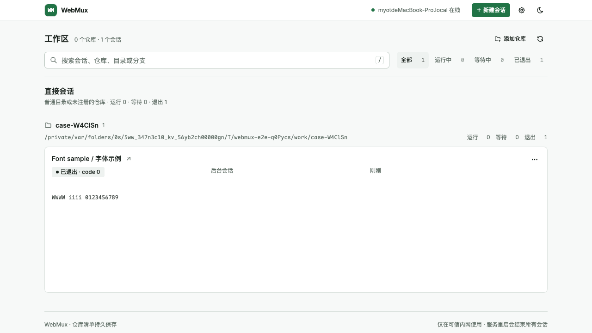
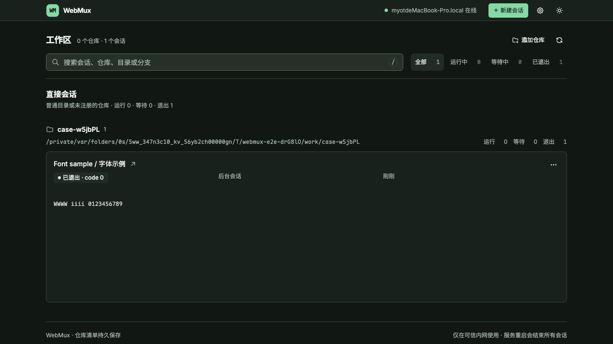
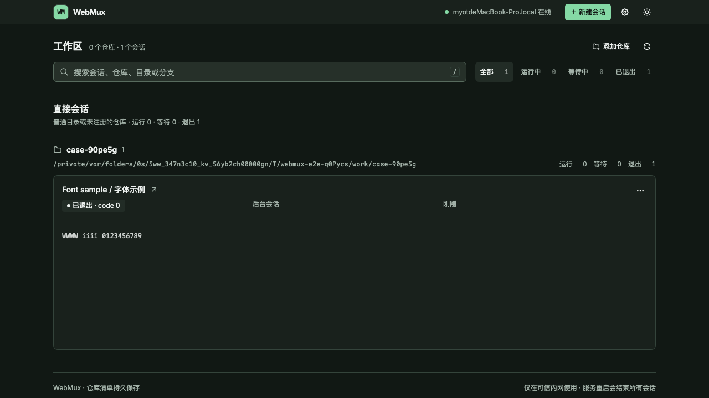
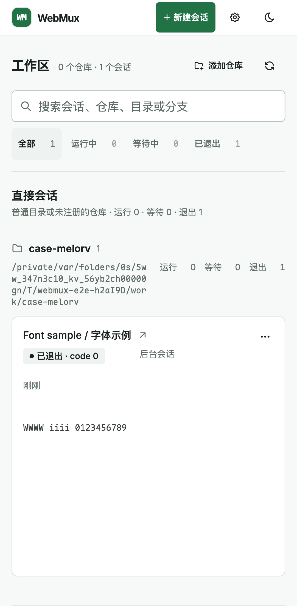
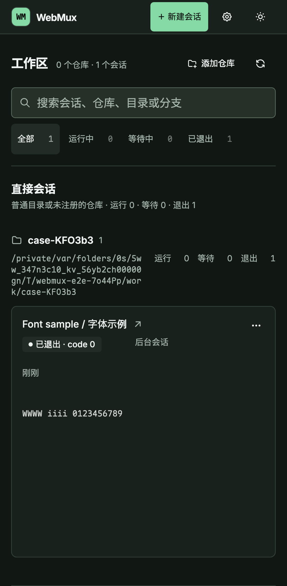
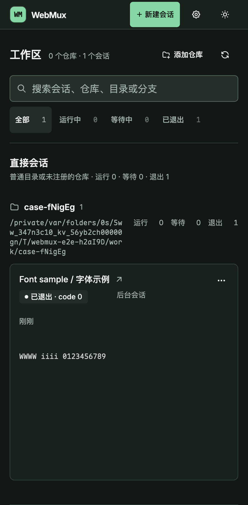

# 内嵌二进制体积

在 macOS arm64 上使用 Go 1.26.1 和同一组发布参数比较上游 `700f043` 与本次修改：`CGO_ENABLED=0`、`-trimpath`、`-ldflags "-s -w -X main.version=0.1.0"`。以下是可执行文件本身的大小，不是下载压缩包。

| 指标                   |       修改前 |       修改后 |   缩减 |
| ---------------------- | -----------: | -----------: | -----: |
| macOS arm64 可执行文件 | 49,956,514 B | 11,873,490 B | 76.23% |
| 内置 WOFF2 字体        | 27,650,668 B |  1,158,984 B | 95.81% |
| WOFF2 文件数           |          818 |           13 |        |

## 打包与字体选择

Vite 保留可供普通静态服务器预览的 `dist`，同时生成确定性的 `dist/embed.zip`。Go 只嵌入 ZIP，通过标准库文件系统按需解压；HTTP 层继续缓存访问过的文件。资源 URL、gzip 协商和缓存策略不变，运行时仍只需要一个二进制。

拉丁界面保留 Inter；终端和代码保留 Maple Mono 的拉丁字形、制表符、Powerline 和 Nerd Font 图标。中日韩文字改用浏览器所在设备的系统无衬线字体，其外观和可用字符取决于该设备安装的字体。

两种字重中 10,329 个轮廓及水平度量相同、且没有 hint 指令的图标共用同一个 WOFF2 文件。有差异或带 hint 指令的字形继续分别保留。共享文件分别声明 `100 500` 和 `600 900` 两个字重范围，与其他 unicode-range 分片保持一致；单独声明 `100 900` 会破坏复合字体匹配，使英文回退为比例字体。

## 验证

- Go race、`go vet`、Svelte/TypeScript、Oxlint 和格式检查通过。
- 90 个 Node 单元测试、67 个 Chromium 组件测试通过。
- 终端、生命周期和代码视图 E2E：31 个通过，3 个按平台跳过。
- 桌面和 Pixel 7 的 4 倍 CPU 性能测试：14 个通过。
- Go 逐文件比较 ZIP 内嵌数据与普通 Vite 输出，覆盖脚本、样式、字体和图片。
- 两种字重各 11,818 个非中日韩码位的集合、轮廓和 advance width 与原字体一致。
- 浏览器在图标字体加载后验证 400/700 字重、14/16px 下 `W` 和 `i` 等宽，且符合 Maple 的 0.6em 字宽。

字体生成使用 Maple v7.9、Inter 5.2.8，生成工具为 Python 3.12.13、fonttools 4.67.0、brotli 1.2.0。普通构建使用提交的字体，无需安装字体生成工具。

## 截图

真实隔离后端中的 `Font sample / 字体示例` 会话，输出固定的 ASCII 示例。设备视口分别为桌面 1280×720 和 Pixel 7 412×839 CSS 像素；临时工作目录名称由测试生成。

| 视口与主题     | 修改前                                                 | 修改后                                                |
| -------------- | ------------------------------------------------------ | ----------------------------------------------------- |
| 桌面 · 浅色    |  |  |
| 桌面 · 深色    |   |   |
| Pixel 7 · 浅色 |   |   |
| Pixel 7 · 深色 |    |    |
